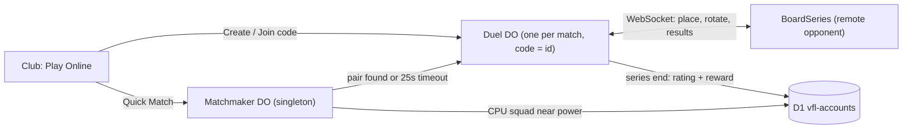

# Online Club Matches: Live Matchmaking, CPU Fallback, Friendly Codes

Replaces `online-matchmaking-and-retention-plan.md`. Everything here is live. No defense rosters, no ghost matches, no async results.

## Goal

1. **Quick Match.** Queue for a live opponent. If nobody suitable turns up in about 25 seconds, play a CPU instead, labelled as a CPU.
2. **Friendly.** Create a 6-character code, send it to a friend, and play a live Bo3 on the 3D board.
3. **Rating.** A simple rating for live wins, plus a First Win of the Day reward that feeds the Club economy.

## What already exists (build on it, don't rebuild it)

| Piece | Where | Reuse |
| --- | --- | --- |
| Lobby Durable Object: 6-char codes, join, hashed session tokens, hibernating WebSockets, alarm deadlines, reconnect by token | [worker/index.js](worker/index.js) (`Lobby`, routes `/api/lobbies`, `/ws/:code`) | Copy the shell (auth, sockets, alarm, per-socket snapshot). Not its game state, which is the 16-player Gauntlet draft. |
| Pure server-side state machine with deadlines | [src/engine/multiplayer.js](src/engine/multiplayer.js) (`applyCommand`, `advanceDeadlines`, `publicSnapshot`) | Same shape for a new `duel.js` |
| Deterministic board rules | [src/engine/board/board.js](src/engine/board/board.js) (`isLegalPlacement`, `isLegalRotation`, `resolveBoard`, `bestPlacement`, `bestRotate`) | The server resolves every map. The AI fills empty or timed-out seats. |
| The opponent seam in the 3D stage | [src/table3d/TableStage.js](src/table3d/TableStage.js): `deal()` computes `oppPlan` with `bestPlacement`, and `resolve()` computes `oppSlots` with `bestRotate` | These two lines become "ask the opponent source". |
| Round setup, tactic hands and map picks | [src/prototype/boardSetup.js](src/prototype/boardSetup.js) (`roundBoard`), `refillTacticHand` and `pickSeriesMaps` in [BoardSeries.jsx](src/components/BoardSeries.jsx) | Run on the server so both sides get the same deal |
| Real players' squads near your power | `club_leaderboard.card_ids` and `power` in D1 `vfl-accounts`, already used for Exhibition ([src/lib/globalLeaderboard.js](src/lib/globalLeaderboard.js)) | The CPU's squad comes from here. No new roster table needed. |
| Signed-in club save | `GET /api/club-save` in [worker/accounts.js](worker/accounts.js) | The server reads the ranked squad from here, not from the client |

## Architecture



### Duel DO (new, one per match)

Uses the same code alphabet and routes pattern as `Lobby`: `POST /api/duels`, `POST /api/duels/:code/join`, `/ws/duel/:code`. Exactly 2 seats. Either seat can be `{ cpu: true }`. `create` takes `bestOf`: 3 or 5 for a Friendly (anything else is rejected). Matchmaker-created duels are fixed at 3.

The state machine lives in `src/engine/duel.js` as pure functions, so it can be tested without a Worker:

```
waiting -> deal(map n) -> place (45s) -> reveal -> rotate (15s) -> resolved(map n) -> ... -> done
```

- **deal:** The server picks the maps (`pickSeriesMaps(seed, bestOf)`) and refills each side's tactic hand. It sends each player their own hand plus the opponent's roster.
- **place:** Each side sends `{ slots, tactics }`, which the server checks with `isLegalPlacement`. Placements stay hidden until both are in or the deadline passes.
- **reveal:** Both placements are broadcast at once.
- **rotate:** Each side sends rotated `slots`, checked with `isLegalRotation(locked, next, roster)`. Each IGL answers the revealed board blind, which is the same rule the stage uses now.
- **resolved:** The server runs `resolveBoard` and broadcasts the result. Clients only animate it, and the server's result wins any disagreement.
- **Timeouts:** A missing placement is filled with `bestPlacement` and a missing rotate with `bestRotate`. The AI that runs CPU seats also fills for a slow or absent human.
- **Disconnects:** The player has 30 seconds to reconnect with their session token, reusing the `join` with `sessionToken` path. After that the AI plays the seat for the rest of the series. In ranked, the leaver takes the loss.
- **Off online:** Timewarp/rewind (`replay`, `spent: ['timewarp']`) and first-match hints are turned off.

### Matchmaker DO (new, singleton `idFromName('global')`)

- A ticket holds `{ participant, rating, power, ranked, enqueuedAt }`, all kept in memory plus storage. One alarm tick runs every 2 seconds.
- **Pairing:** match on rating within ±100, widening by 50 every 5 seconds, and power within ±15%, also widening. Never pair someone with themselves.
- **Timeout at 25 seconds:** create a Duel with a CPU seat. The CPU's squad is a `club_leaderboard` row closest in power (excluding your own), run by `bestPlacement`/`bestRotate` with the same `rng` noise the NPCs use. The UI says "No opponent found. Playing CPU" and shows that club's name tagged CPU.
- The client polls `GET /api/match/ticket` or holds a WebSocket. Pick whichever matches the lobby client. On a match it gets `{ duelCode, sessionToken }` and connects to the Duel.

`wrangler.jsonc` needs a migration `{ "tag": "v2", "new_sqlite_classes": ["Duel", "Matchmaker"] }` plus bindings `DUELS` and `MATCHMAKER`.

### Where squads come from (trust)

- **Ranked (Quick Match):** sign-in required. The Duel reads the player's starters, trained stats, skills and chips from their D1 club save. Client-sent stats are ignored.
- **Friendly:** guests are allowed. The client sends its 5 starters, and the server checks card ids against `cards.json` plus stat caps. Nothing is at stake, so this is enough.
- **Known limit:** the club save itself is still written by the client (`PUT /api/club-save`), so a determined cheater can edit their save. Server-side save validation is a separate job.

### Rating and rewards

New migration `worker/migrations/accounts/0003_club_rating.sql`:

```sql
CREATE TABLE club_rating (
  user_id TEXT PRIMARY KEY REFERENCES users(id) ON DELETE CASCADE,
  rating INTEGER NOT NULL DEFAULT 1000,
  games INTEGER NOT NULL DEFAULT 0,
  wins INTEGER NOT NULL DEFAULT 0,
  first_win_day TEXT,            -- YYYY-MM-DD (UTC) of the last First Win reward
  updated_at INTEGER NOT NULL
);
```

- **Who writes it:** only the Duel DO, at series end. There's no "report result" endpoint, so there's nothing for a client to replay or forge.
- **Elo:** K=32 for the first 20 games, then K=16. Lives in `src/engine/club/rating.js` (`ratingDelta(a, b, won)`).
- **Bot matches:** no rating change. They still count for First Win of the Day, so a player who only ever gets the CPU still has a reason to play.
- **Friendlies:** no rating change, no rewards.
- **Rewards:** the final `done` message includes `{ ratingBefore, ratingAfter, firstWin: bool }`, and the client applies the pack or tape to the save the same way `finishMatch` does now.
- **Rank names:** a bucketed label over rating (`rankFor(rating)`), with no floors or divisions yet. Add floors only if real players start sliding down the ladder.

## Client

- **BoardSeries and TableStage:** add an optional `opponent` prop (`{ place(game): Promise<plan>, rotate(mine): Promise<slots> }`). If it's missing, they use the current local AI (`bestPlacement` / `bestRotate`), so Season, Exhibition and Gauntlet don't change. Online passes a socket-backed source, and the stage waits on reveal/rotate until the server answers. `resolve()` takes the server's result when one is given. Change it in `TableStage.js` only. `BoardStage.js` is the 2.5D prototype; leave it alone unless online needs it.
- **Timer:** the place and rotate phases show the server deadline, using `serverNow` the same way the lobby deadline events do.
- **Online client** (`src/lib/duelClient.js`): create, join, queue and cancel. Socket connect, reconnect and backoff come from the existing lobby client in `src/engine/multiplayer.js` or its UI. Reuse whatever it already has rather than writing a second socket layer.
- **Screens in `Club.jsx`:** a **Play Online** entry next to Exhibition with three actions: **Quick Match** (primary, `--accent`), **Create code** and **Join code**.
  - **Searching:** elapsed time and Cancel. At timeout it hands over to the CPU intro with no extra click.
  - **Code room:** Bo3/Bo5 choice (creator only, before the code is made, as an `ItemChoice` pair), the code in large type, a copy-link button, and the opponent's slot showing "Waiting" until they join. The match starts when both are connected.
  - **Result:** rating change and First Win reward if earned, then back to Club.
- **Rules to follow:** [docs/ui-rules.md](docs/ui-rules.md). Reuse `ManagementScreen`, `ScreenHeader` and `ItemChoice`. No ` · ` separators. Every string goes through `t()` with en/es/pt.

## Build order

Each phase ships and gets played on its own.

1. **Duel engine and Friendly codes.** `duel.js`, `Duel` DO, the `opponent` seam in TableStage, the code room UI with Bo3/Bo5. **Done when** two browsers (one incognito) finish a Bo3 and a Bo5 with server-resolved maps; killing one tab hands its seat to the AI after 30 seconds; both screens show the same result.
2. **CPU seat.** A Duel with `{ cpu: true }` plays out through the same path. **Done when** a solo friendly vs CPU completes.
3. **Matchmaker.** Queue, widening band, 25-second CPU fallback. **Done when** two signed-in accounts queued at the same time get paired, and a lone account gets a labelled CPU at about 25 seconds.
4. **Rating and First Win.** Migration, Elo, `done` payload, client reward. **Done when** a live win moves rating on both rows and a second win the same day gives no second First Win.

Later, only if numbers justify it: rank floors, weekly milestones, the leave-penalty cooldown, and a "level stats" toggle for friendlies.

## Tests

- `test/duel.test.js` (pure engine):
  - Both sides submit and get the same `resolveBoard` result as calling it directly.
  - A missing placement or rotate at the deadline gets AI-filled.
  - An illegal placement is rejected.
  - An illegal rotation is rejected: too many moves, or a lurker moved.
  - Hidden placement doesn't leak in `publicSnapshot` before reveal.
  - A Bo3 ends at 2 wins and a Bo5 at 3.
  - `bestOf` other than 3 or 5 is rejected at create.
- `test/matchmaker.test.js`:
  - The pairing band widens over time.
  - A player is never paired with themselves.
  - Timeout produces a CPU ticket with the nearest-power squad.
- `test/rating.test.js`:
  - Elo is symmetric.
  - K drops after 20 games.
  - A bot match doesn't change rating.
  - First Win is granted once per UTC day.
- `npm test`, plus the i18n parity check.

## Decisions (locked 2026-11-07)

1. **Ranked requires Discord sign-in.** Guests can play Friendlies only. The Quick Match button for a guest leads to sign-in.
2. **CPU shows the real club name it borrowed, tagged CPU.**
3. **Series length:** Quick Match is always Bo3. In a Friendly, the code creator picks Bo3 or Bo5 when creating the room. The joiner sees the choice before the match starts.

## Built (2026-11-07)

All four phases are in. Where the build differs from the plan above:

- **Ranks are Iron to Radiant** (user's call), 100 rating apart: Iron under 900, Silver from 1000 (the start), Radiant from 1600. `src/engine/club/rating.js`.
- **The way in is the hub, not League.** The Club hub has a Season / Online switch. Online swaps the week road for a rank strip (rank, rating, meter to next rank, last five results, First win) and the hero for Find match on the big red button, with Play a friend under it. `src/components/club/OnlineHub.jsx`.
- **Between maps:** a 30s timer (`BETWEEN_MS`) drains across the Ready button; both ready deals at once. The place clock starts at the deal.
- **The queue is polled**, not a socket: `/api/match/ticket/:id` every 1.5s. A ticket nobody polls for 10s leaves the queue.
- **Ranked squads** are sanitized and clamped like friendlies; the server does not rebuild them from the D1 club save (that save is client-written anyway).
- **The CPU** borrows the nearest-power club from `club_leaderboard`; with an empty table it plays a "Pickup Five" near your power.
- **First Win of the Day** pays one silver pack, applied on the client.

Deploy: `npx wrangler d1 migrations apply vfl-accounts --remote` (adds `club_rating`), then deploy. The `v2` Durable Object migration creates `Duel` and `Matchmaker`.
