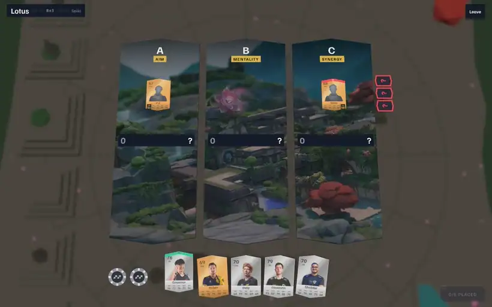
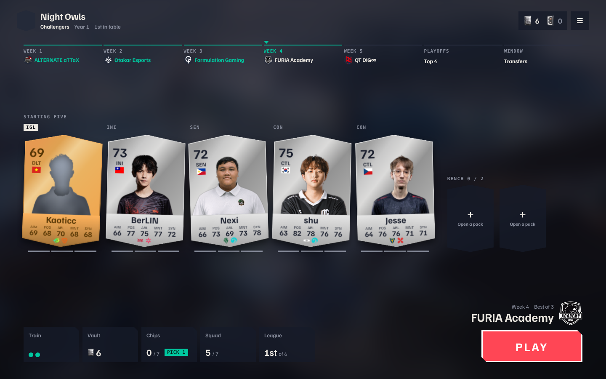
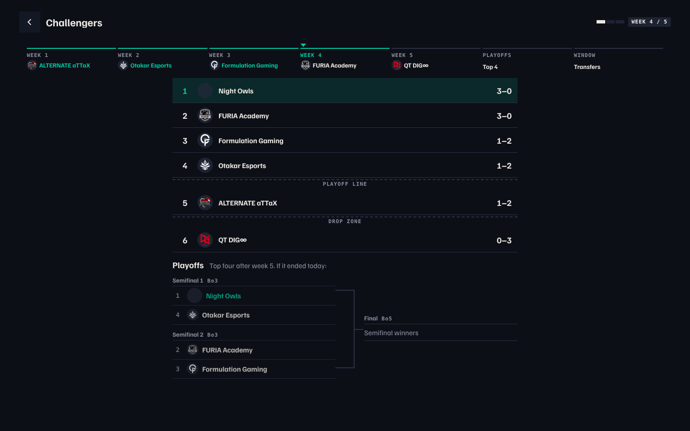
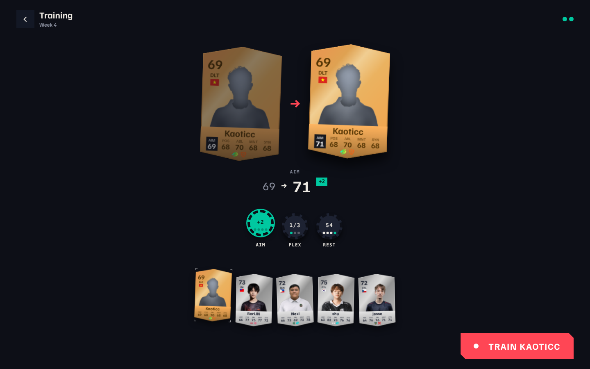
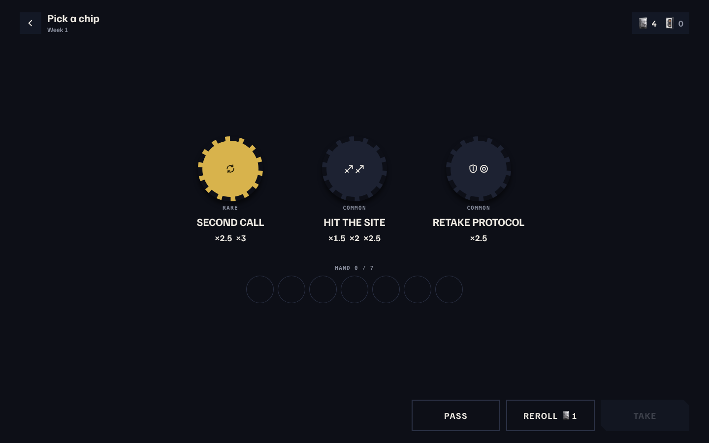
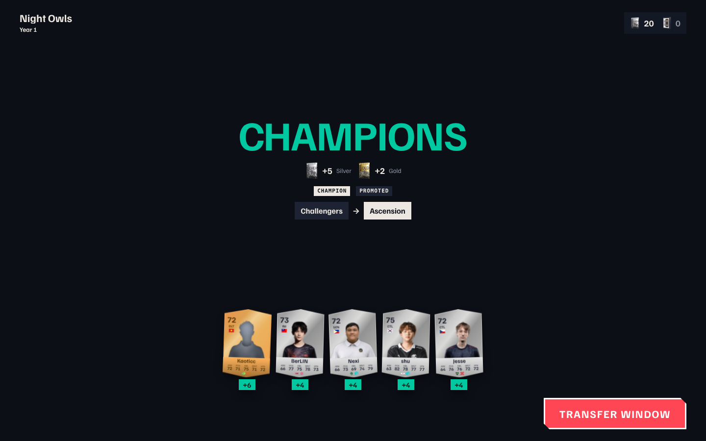
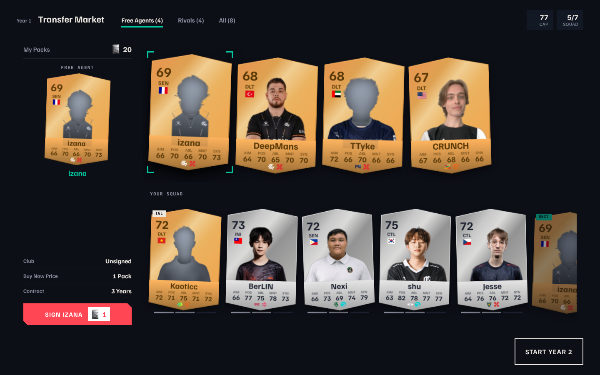
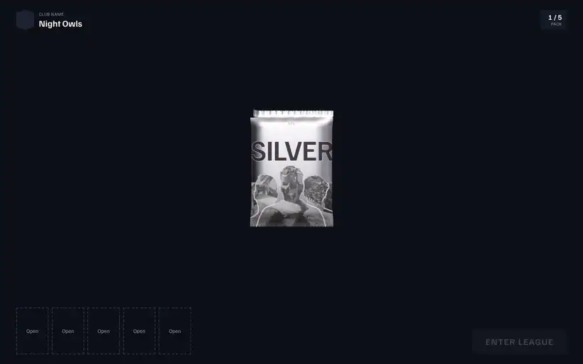

# Clubs

**Run a club. Sign VCT pros. Win the league, year after year.**

A fan-made Valorant card game built on real VCT players. Draft five cards, place them on the board, and climb from Challengers to the International tier. No account needed, no money.

One match round, from the app. The placing is sped up about ten times, and the lock-in and the lane results play at normal speed.

## Why

Fantasy games usually ask you to pick a team and wait. Card games usually ask you to open packs and hope.

Clubs sits in between. You build a squad of real pros, but every match is a small puzzle you play yourself: where does each card go, and what does the other club expect? Between matches you train, renew contracts and shop in a transfer window, so a good club is something you grow over several years, not a lucky pull.

## Features

- **Real players:** more than 1,000 cards, one for each pro from VCT, Challengers and the all-time Icons, with their teams, countries, roles and agents.
- **A match you play, not watch:** drag five cards onto three lanes, then lock in. Your rival's lineup stays hidden until you do.
- **Chips:** tactic cards that multiply a lane. Win a series and pick one of three. Your hand holds up to seven.
- **A league that remembers:** five weeks of fixtures, a top-four playoff and a transfer window each year. A strong year gets you promoted. Finish last twice in the bottom tier and you are sacked.
- **Contracts, not a roster you keep forever:** every player has one to three years left, and anyone on their last year can move. Nothing in the window is a dice roll. A rival only takes your player if you let them.
- **Training:** raise a stat, learn a skill, or rest. Players grow, tire and age on a career clock.
- **Packs you tear open:** Silver, Gold and Icons packs, in a 3D pack you rip by hand. Spend a pack in the market, or open it to pick one of three players. A pity counter guarantees a Gold, and every second title earns an Icons pack.
- **Saves on your device, or to your account:** the game runs in your browser and your club lives in local storage. Signing in with Discord is optional and saves the club to your account so it follows you to any device.

## Play

**[Play it in your browser](https://vctfantasy.dimas.works)**, no install and no sign-up needed. A desktop or laptop is the best fit for now.

1. Name your club and tear open five packs. From each, keep one of three players.
2. Press **Play** on the home screen for this week's fixture.
3. Drag your five players onto the three lanes (one to three per lane), then press **Lock in**.
4. Use your IGL's rotate if you want to move a player after seeing the lanes, or go without.
5. Win two lanes to take a map, and two maps to take the series (Bo3 in the league, Bo5 in the final).

| Do this | To |
| --- | --- |
| <kbd>Space</kbd> or <kbd>Enter</kbd> | Tear open a pack |
| Drag a card | Place it on a lane |
| **Lock in** | Commit your lineup |
| **Go without rotating** | Skip the IGL rotate |
| **Next round** | Move on to the next map |
| <kbd>Esc</kbd> | Go back, or close the club menu |

### How a match works

A series is a set of maps, and each map has three lanes. Every lane scores one stat (aim, ability, mentality, positioning or synergy), so the same five players are worth different amounts in different places.

- A lane is a plain sum of its players' stat. Combos add on top: a role pair is worth +20, teammates +15 and a shared country +8.
- Skills bend the rules. **One Trick** adds 20 on maps that suit the agent, **Flick** scores a player's best stat when they play a lane alone, **Mastermind** gives an IGL two rotates, and **Aura** takes 15 from the enemy on that lane.
- Only a chip multiplies. Chips pay by who is on the lane, in half steps (x1.5, x2, x2.5) you can work out in your head.
- A chip you play on a won map comes back to your hand. One you play on a lost map is burned.

## Screenshots

<table>
  <tr>
    <td width="50%"></td>
    <td width="50%"></td>
  </tr>
  <tr>
    <td align="center">Home: your five, the week's fixture and the season calendar</td>
    <td align="center">League table, playoff line and bracket</td>
  </tr>
  <tr>
    <td width="50%"></td>
    <td width="50%"></td>
  </tr>
  <tr>
    <td align="center">Train a stat, learn a skill or rest</td>
    <td align="center">Win a series, then pick one of three chips</td>
  </tr>
  <tr>
    <td width="50%"></td>
    <td width="50%"></td>
  </tr>
  <tr>
    <td align="center">Year review: a title, packs and a promotion</td>
    <td align="center">The transfer window</td>
  </tr>
  <tr>
    <td colspan="2"></td>
  </tr>
  <tr>
    <td colspan="2" align="center">Founding your club: tear a pack, keep one of three</td>
  </tr>
</table>

## The seasons

| Tier | What it means |
| --- | --- |
| Challengers | Where every club starts. A first squad is drafted to sit here, so year one is a climb. |
| Ascension | Promotion after a strong year, against stronger rivals. |
| International | The top. Reaching it unlocks an extra bench place, and your club's reputation decides which stars you can sign, up to the Icons. |

A year is five league weeks, a top-four playoff, a review and one transfer window. Each series win earns a Silver pack, and the year end pays three more. A title adds two Silver and two Gold, a top-three finish adds one Gold, and every second title adds an Icons pack.

There is no hidden difficulty dial. Which tier you are in is the difficulty: a club that keeps losing drops to a league it can beat, and one that keeps winning is promoted to rivals that can beat it.

## Design notes

The pack and reward system was planned in [docs/club-rewards-plan.md](docs/club-rewards-plan.md), and its choices lean on a few observations from other card games. The sources there are mostly community guides, with no developer postmortems and no FIFA Ultimate Team economy data, so treat them as direction, not proof.

- **Keep a deterministic path next to the random one.** Marvel Snap shows one card you don't own in its Token Shop, as the counterpart to random caches ([Naavik](https://naavik.co/digest/marvel-snap-card-acquisition-spotlight-caches/)). The transfer window is Clubs' version: you can always buy the player you want.
- **Cap the worst dry streak.** Gacha design literature lays a fixed pity counter over a variable reward, and recommends showing the counter ([DiGRA](https://dl.digra.org/index.php/dl/article/download/2731/2717/2777)). The vault shows how close the next Gold is.
- **Don't make the fallback stingy.** Pokemon TCG Pocket drew complaints for restrictive pity points and for long animations ([OneEsports](https://www.oneesports.gg/gaming/pokemon-tcg-pocket-pity-system-explained/)), so every pack tear can be skipped.
- **Packs as the reward for play.** FUT's Squad Building Challenges pay packs and consume the items you hand in ([EA help](https://help.ea.com/en/articles/ea-sports-fc/squad-building-challenges/)). Clubs pays packs for series, titles and promotion.

The ratings are not real match stats. Every card carries five synthetic stats (aim, positioning, ability, mentality, synergy) from 0 to 99, and the whole simulation runs on those.

## Status

Clubs is early and still changing quickly. It replaced two older modes, the Gauntlet and Multiplayer. The notes on what was removed are in [docs/club-cleanup-plan.md](docs/club-cleanup-plan.md).

- **Languages:** English, Portuguese (Brazil) and Spanish.
- **Some players have no photo yet** and show a silhouette.
- **Without an account, browser storage is the only save.** Clear your site data, or switch browsers or devices, and the club is gone. Signing in with Discord (optional) keeps it in the cloud.
- **Leftover server code.** The Worker still contains daily-score and lobby code from the removed modes. Nothing in the app calls it.

---

Music by <a href="https://pixabay.com/users/atlasaudio-54514918/?utm_source=link-attribution&utm_medium=referral&utm_campaign=music&utm_content=617620">AtlasAudio</a> from <a href="https://pixabay.com//?utm_source=link-attribution&utm_medium=referral&utm_campaign=music&utm_content=617620">Pixabay</a>. Map art by Riot Games environment artists [Tobias Koepp](https://www.artstation.com/tobiaskoepp) and [Kevin Brunt](https://www.artstation.com/sirdigitalbacon), and official VALORANT wallpapers.

Clubs is a fan project with no monetization. It is not affiliated with or endorsed by Riot Games. VALORANT, the VCT and related names belong to Riot Games.
